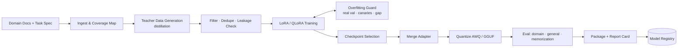

# Domain Expert Factory: System Architecture

> An end-to-end factory that turns domain documents into a small, fast, quantised expert model: teacher-generated data, LoRA fine-tuning, overfitting guards and edge-ready quantisation.
>
> **Concepts:** `Fine Tuning`, `LoRA`, `Overfitting`, `Knowledge Distillation`, `Quantization`, `LLMs`

## 1. High-Level View

A DAG pipeline (Dagster/Prefect) with stages: ingest → generate → filter → train (with guard callbacks) → select → merge → quantise → evaluate → package. Each stage writes versioned artifacts and metrics to a registry.

## 2. Components

| Component | Responsibility |
|---|---|
| Coverage map | Topic clustering of docs to drive balanced generation. |
| Generator | Teacher prompts with grid sampling; outputs with source refs. |
| Filter | Consistency voting, grounding check, MinHash dedupe, leakage vs eval set. |
| Trainer | TRL + PEFT with guard callbacks. |
| Guard | OverfitRadar-style detectors on real held-out set. |
| Quantiser | AWQ + llama.cpp. |
| Evaluator | Domain rubric, general regression, canary extraction. |

## 3. Request / Data Flow

1. Define task + upload docs + seed examples (≥ 50 real, split into val/test).
2. Generate 10–30k synthetic examples within budget.
3. Filter to high-quality set.
4. Train LoRA with guard; stop on divergence.
5. Select best checkpoint on real val.
6. Merge + quantise; re-evaluate; package with report card.

## 4. Data Stores

| Store | Holds | Why |
|---|---|---|
| S3 + LakeFS | Datasets, artifacts | Versioned. |
| MLflow | Runs + registry | Lineage. |

## 5. Deployment Topology

- Cloud GPUs for training; output runs on vLLM (GPU) or llama.cpp (CPU/edge).

## 6. Scaling Strategy

- Parallel generation with rate limits; Batch API for cost.

## 7. Security & Privacy

- Docs stay in customer VPC; teacher via zero-retention API agreements.

## 8. Observability

- Stage durations, teacher spend, guard alerts, eval deltas.

## 9. Failure Modes

| Failure | Detection | Response |
|---|---|---|
| Guard triggers repeatedly | Alert count | Reduce epochs/rank; increase data diversity; human review. |
